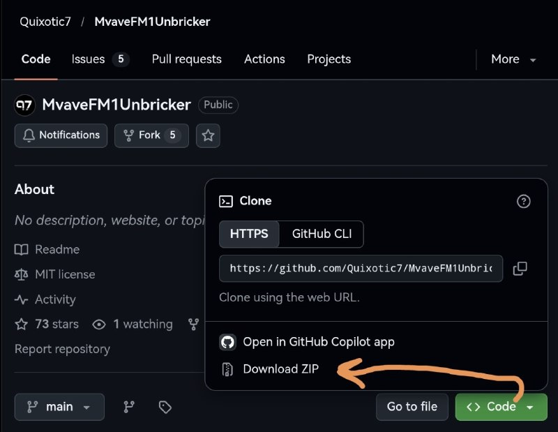
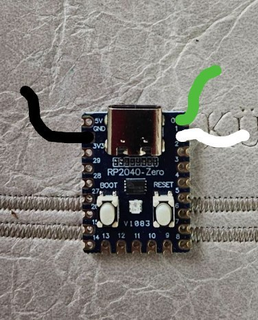
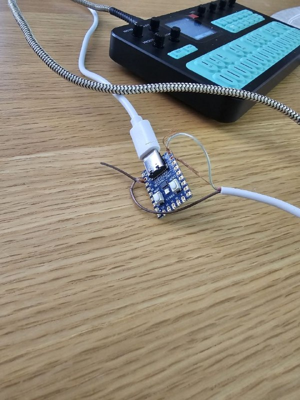

# How to Unbrick the M-VAVE FM1 (for Dummies)

[Русская версия](README_RU.md)

This guide explains how to bring your FM1 back to life after a **hard brick**. It should also work for a soft brick.

A **hard brick** is a state in which the FM1 won't power on and isn't detected by other devices, although the charging indicator still works.

We'll be using the simplest, cheapest, and least elegant unbricking method. No soldering is required, although soldering is also an option if you prefer.

## What you'll need

- A Windows PC.
- The original v15 firmware file: `FM-1v15.fwsc`.
- An RP2040-Zero controller board.

  

- A USB-C cable capable of data transfer, to connect the RP2040 to your PC.
- A USB-C cable to connect the RP2040 to the FM1. It must have four separate wires inside: one end should be a USB-C male plug, and the other end should expose four individual wires (black, red, white, and green).

  
  ![USB-C cable with four exposed wires]](images/04-rp2040-wiring2.jpg)

- The M-VAVE FM1 itself.
- The latest version of Python installed on your PC: [python.org/downloads](https://www.python.org/downloads/).
- The archive [MvaveFM1Unbricker by Quixotic7](https://github.com/Quixotic7/MvaveFM1Unbricker), downloaded and extracted.

  

## Unbricking procedure

1. **Connect three of the four wires to the RP2040 board:**
   - Black to `GND`
   - Green to `0`
   - White to `1`
   - Leave the red wire disconnected.

   

   You can solder the wires directly to the contacts. One option is to solder pins to the board first and then attach the wires to those pins. Alternatively, you can simply secure the wires tightly, as shown in the photos above.

2. Hold down the `BOOT` button on the RP2040 and connect it to your PC while keeping the button pressed. A File Explorer window should appear. You can release the `BOOT` button.

3. In the `MvaveFM1Unbricker-main/transporter` folder, find `fm1_transporter-a632d92-placeholder.uf2` and drag it into the File Explorer window from the previous step. The window will close.

4. Disconnect the RP2040 from your PC, then connect it again. Nothing will happen — that's normal.

5. Copy the firmware file `FM-1v15.fwsc` into the `MvaveFM1Unbricker-main` folder.

6. In the `MvaveFM1Unbricker-main` folder, hold down `Shift`, right-click an empty area, and choose an option similar to **Open in Terminal** or **Open PowerShell window here**. A terminal window will open.

7. At this point, the RP2040 should be connected to your PC. Nothing else should be connected. Copy and run this command in the terminal:

   ```bash
   python3 fm1_transporter_recover.py setup
   ```

   Answer `Y` to all prompts and press `Enter` whenever prompted.

8. Using the USB-C cable with the wires attached, connect the RP2040 to the FM1. The FM1 must be switched off.

   

9. Copy and run this command in the terminal:

   ```bash
   python3 fm1_transporter_recover.py wizard --v15 FM-1v15.fwsc
   ```

   Follow the instructions. Answer `Y` wherever possible and press `Enter` when prompted. At one point, you'll be asked to type `WRITE`.

10. Once all activity in the terminal has stopped, disconnect the FM1. Switch it off and then back on. Firmware v15 should now boot.

11. Update/flash it with whichever firmware version you want, using the usual procedure.

---

**Original recovery utility:** [Quixotic7/MvaveFM1Unbricker](https://github.com/Quixotic7/MvaveFM1Unbricker)
