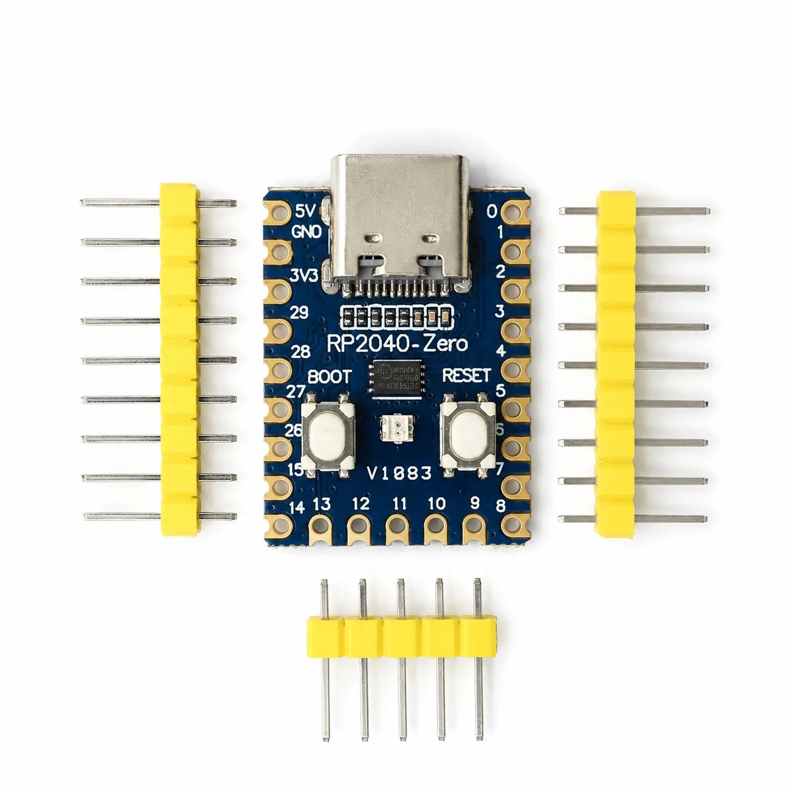
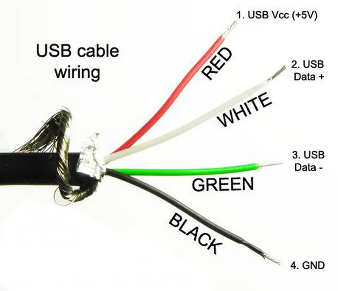
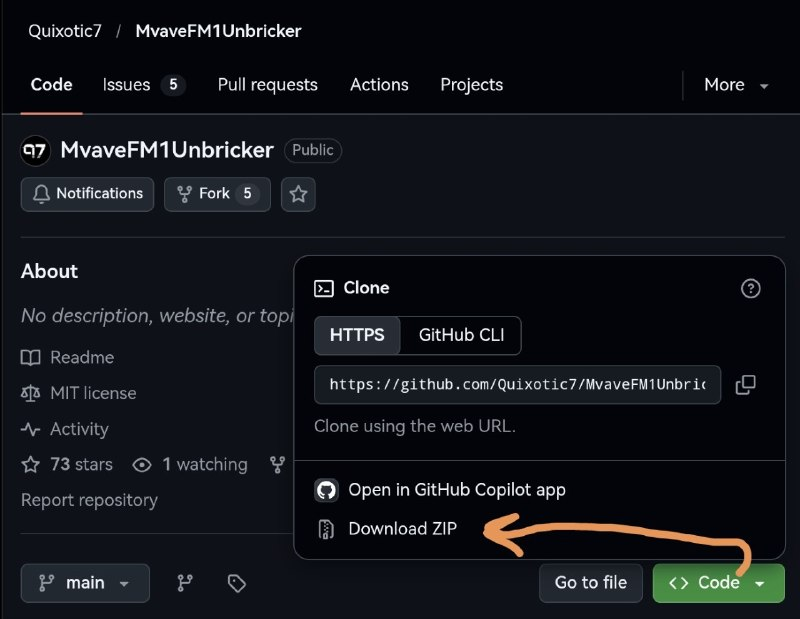
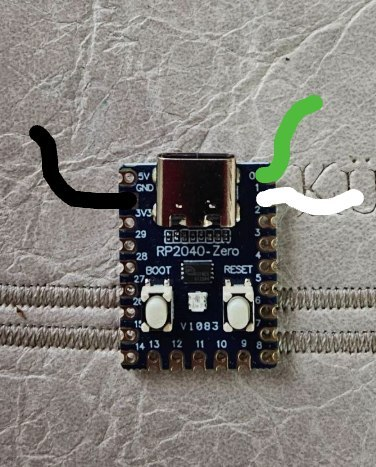
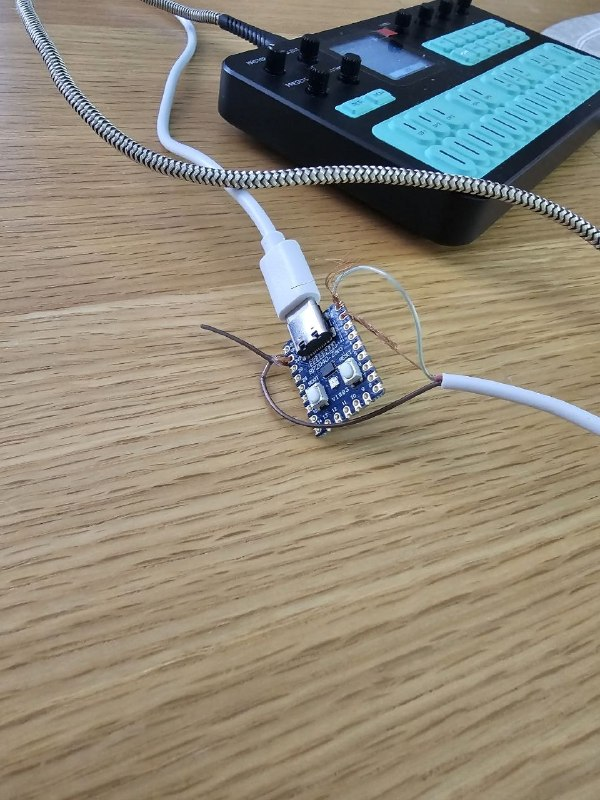

# Как восстановить M-VAVE FM1 после «кирпича» (для чайников)

[English version](README.md)

Это руководство объясняет, как вернуть FM1 к жизни после **хард-брика**. Для софт-брика процедура тоже должна подойти.

**Хард-брик** — состояние, при котором FM1 не включается и не определяется другими устройствами, хотя индикатор зарядки продолжает работать.

Мы рассмотрим самый простой, дешёвый и кривой способ анбрика. Без пайки, хотя такая опция имеется и остается на ваше усмотрение

## Что понадобится

- ПК с Windows.
- Оригинальная прошивка v15: `FM-1v15.fwsc`.
- Контроллерная плата RP2040-Zero.

  

- USB-C кабель с поддержкой передачи данных для подключения RP2040 к ПК.
- USB-C кабель для подключения RP2040 к FM1. Внутри обязательно должны быть четыре отдельных провода: с одной стороны — штекер USB-C (папа), с другой — четыре отдельных провода (чёрный, красный, белый и зелёный).

  

- Собственно, M-VAVE FM1.
- Последняя версия Python, установленная на ПК: [python.org/downloads](https://www.python.org/downloads/).
- Скачанный и распакованный архив [MvaveFM1Unbricker от Quixotic7](https://github.com/Quixotic7/MvaveFM1Unbricker).

  

## Процедура восстановления

1. **Подключаем три из четырёх проводов к плате RP2040:**
   - Чёрный — к `GND`
   - Зелёный — к `0`
   - Белый — к `1`
   - Красный не подключаем.

   
   

   Их можно припаять прямо к контактам. Или сначала припаять ножки, а к ножкам провода. Либо просто крепко примотать, как на фото выше.

3. Зажимаем кнопку `BOOT` на RP2040 и, не отпуская её, подключаем плату к ПК. Должно открыться окно Проводника. После этого кнопку `BOOT` можно отпустить.

4. В папке `MvaveFM1Unbricker-main/transporter` находим файл `fm1_transporter-a632d92-placeholder.uf2` и перетаскиваем его в окно Проводника из предыдущего шага. Окно закроется.

5. Отключаем RP2040 от ПК и подключаем обратно. Ничего не произойдёт — так и должно быть.

6. Копируем файл прошивки `FM-1v15.fwsc` в папку `MvaveFM1Unbricker-main`.

7. Находясь в папке `MvaveFM1Unbricker-main`, зажимаем `Shift`, нажимаем правой кнопкой мыши на пустом месте и выбираем пункт вроде **«Открыть в терминале»** или **«Открыть окно PowerShell здесь»**. Откроется окно терминала.

8. На этом этапе RP2040 должна быть подключена к ПК. Больше ничего подключать не нужно. Копируем в терминал и запускаем команду:

   ```bash
   python3 fm1_transporter_recover.py setup
   ```

   На все вопросы отвечаем `Y` и нажимаем `Enter`, когда попросят.

9. С помощью USB-C кабеля с отдельными проводами подключаем RP2040 к FM1. Сам FM1 должен быть выключен.

10. Копируем в терминал и запускаем команду:

   ```bash
   python3 fm1_transporter_recover.py wizard --v15 FM-1v15.fwsc
   ```

   Следуем инструкциям. Где возможно, отвечаем `Y` и нажимаем `Enter`, когда попросят. В какой-то момент потребуется ввести `WRITE` и сразу после включить ФМ1.

11. Когда вся активность в терминале завершится, отключаем FM1. Выключаем его и снова включаем. Должна запуститься прошивка v15.

12. После этого можно прошить поверх любую другую версию прошивки обычным способом.

---

**Утилита для восстановления:** [Quixotic7/MvaveFM1Unbricker](https://github.com/Quixotic7/MvaveFM1Unbricker)
